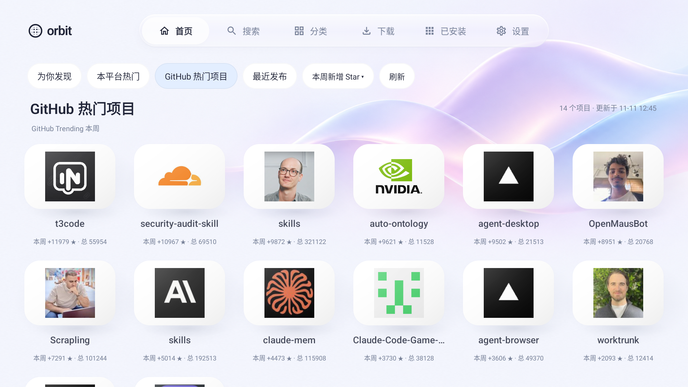
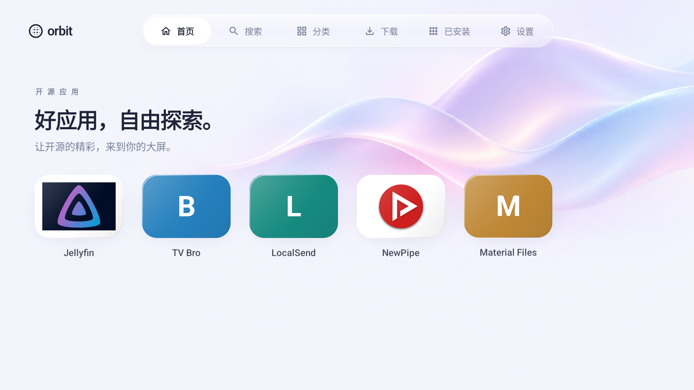
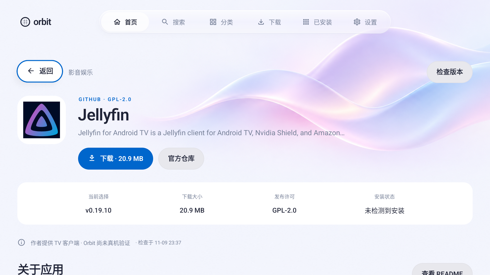
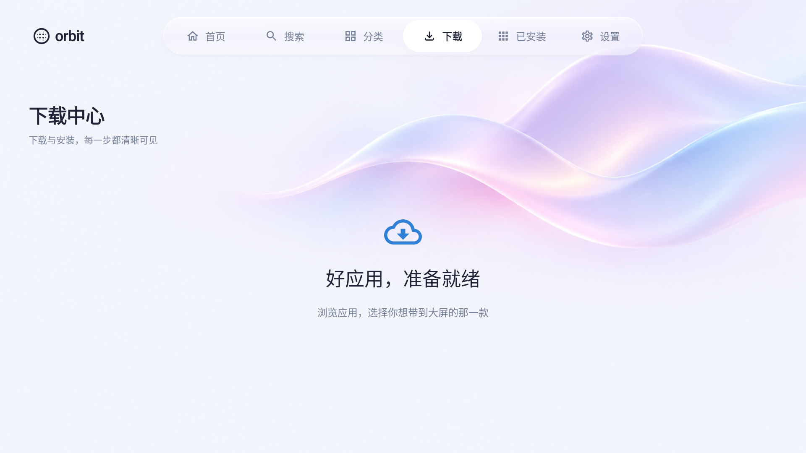
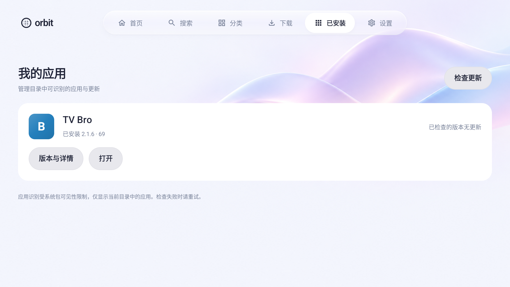

# Orbit 开源商店

一款面向 Android TV 的 GitHub 应用发现、下载、安装与更新工具。无需运营后台、人工上架或维护应用名单，保留 Apple tvOS 风格的浅色玻璃导航、流光背景与遥控器焦点动效。

目前为 **v0.3.1-dev 工具化开发版**。首页由客户端自动发现，搜索覆盖 GitHub 公开仓库；图标和 README 在线获取，安装由用户自主选择并通过系统确认。后续平台尚未开发。

## 界面预览

最新紧凑首页与网络策略见[请求优化及布局记录](docs/github-network-and-layout.md)。首页已压缩标题和筛选区域，标准 TV 布局首屏可显示两行六列。

[](docs/screenshots/home-compact-live.png)

上图为 v0.3.1-dev 模拟器真实运行画面，部分图片是作者头像回退，数据随 GitHub 变化。以下详情 / 下载画面来自前期版本，原截图不代表固定推荐名单。

| 首页发现 | 应用详情 |
| :---: | :---: |
| [](docs/screenshots/home.png) | [](docs/screenshots/details.png) |
| **下载中心** | **我的应用** |
| [](docs/screenshots/downloads.png) | [](docs/screenshots/library.png) |

[查看真实 GitHub 全站搜索截图](docs/screenshots/github-search-live.png)。

[查看实际动效录屏](docs/screenshots/navigation.mp4)（模拟器，约 18 秒）。[720p 布局截图](docs/screenshots/home-720p.png)与[图标聚焦截图](docs/screenshots/home-focused.png)可单独查看。视觉、过渡时长、焦点与减少动态效果的规则见[界面设计记录](docs/ui-design.md)。前期安装链路的真实记录保存在[安装完成截图](docs/screenshots/downloads-installed.png)和[系统确认截图](docs/screenshots/system-install.png)。

## 当前功能

- 自动发现 Android TV 相关应用；平台热门默认按近期新增 Star，支持今日 / 本周 / 本月及总 Star 排序，另有独立跨平台“GitHub 热门项目”入口和最近发布。
- GitHub 全站仓库搜索、分页与 `owner/repo` / GitHub 仓库地址直达；不再限定五个开发样本。
- 应用内 README 正文阅读：标题、样式、列表、表格、代码、图片、链接、折叠内容及锚点；按实际存在的 README 提供语言切换，记住选择，不自动翻译。
- CommonMark 解析、Compose 懒渲染、在线图片和容量缓存；不引入 WebView，不随 APK 打包第三方图标。复杂公式 / 图表等保留原文入口。
- GitHub API 共享额度与串行调度，缓存 / ETag 复用，按可见项目补资料；可选设备验证码授权，Client ID 可在构建或设置中配置。
- 详情默认最新稳定版；打开菜单后再获取历史版本，其他 APK 变体也可通过菜单选择。真实包信息在下载后核对。
- 前台下载队列、大文件最多四路分段、断点续传、失败重试和 Range 不支持时降级；无上游摘要时单独说明，使用可靠验证器恢复，不假装已完成上游摘要验证。
- 目录外仓库也可下载独立 APK；安装前显示来源、真实包名、版本和证书，由用户确认。包名、签名、系统要求、ABI 与文件检查不因协议免责而取消。
- 收藏、订阅和本机安装关联独立保存；支持主动关联外部安装、包级更新检查与稳定 / 预发布渠道、忽略版本、打开及卸载。
- 只周期检查订阅与有效关联的应用，支持关闭自动检查；新 Release 不直接冒称可升级，不自动下载或静默安装。
- 详情返回来源列表回到顶部并保持焦点可见，保留搜索、分类和已加载结果；README 子文档与图片预览返回保留上层阅读位置。
- 首次第三方下载前主动同意协议；设置提供协议、开源许可、减少动画、缓存清理、恢复隐藏项目及用户数据清除。

热门数据有来源与统计时间，缺少增长数据不会用总 Star 冒充；当前结果只覆盖受请求预算限制的候选，不承诺全站排名。GitHub 限流或无法访问时保留可用缓存，不转用未经说明的第三方代理。

公开仓库不一定开源或安全。TV 相关标签、签名一致和文件校验都不代表人工安全审核或真机认证；用户自行判断第三方软件，详见[用户协议](app/src/main/assets/user-agreement.txt)。独立 APK 以外的 Split APK / XAPK / AAB 不支持。

## 技术栈

| 领域 | 技术方案 |
| --- | --- |
| 客户端 | Kotlin、Jetpack Compose、Compose for TV |
| 状态与异步任务 | ViewModel、Coroutines / Flow、WorkManager |
| 网络与图片 | OkHttp、Coil |
| 本地持久化 | 原子 JSON 文件、SharedPreferences |
| 下载与安装 | 前台 dataSync 服务、PackageInstaller、PackageManager |
| 正文与 HTML 数据解析 | CommonMark 0.24.0（含 GFM 表格）、jsoup 1.21.2；原生渲染，无脚本执行 |
| 本机校验 | SHA-256、PackageManager、实际 APK 包身份与系统安装器 |
| 构建与测试 | Gradle、JUnit、Compose UI Test、UI Automator、GitHub Actions |

## 构建与运行

需要 JDK 17、Android SDK API 35、Build Tools 35.0.0。最低支持 Android 8.0 / API 26。用 Android Studio 打开仓库并同步 Gradle，或设置好 `ANDROID_HOME` 后运行：

```bash
./gradlew assembleDebug
```

APK 输出：`app/build/outputs/apk/debug/app-debug.apk`。

```bash
adb install -r app/build/outputs/apk/debug/app-debug.apk
adb shell am start -n dev.githubstore/.MainActivity
```

首次安装其他应用时，需要在系统设置中允许 Orbit 安装来源，并在系统弹窗确认。开发 APK 使用本机调试证书；正式发行必须配置持久保存的发布证书。不同证书之间不能直接覆盖更新。

当前工作区安装的 SDK、Gradle 和模拟器位于 `.tooling/`，已排除在 Git 之外。`local.properties`、下载缓存和调试密钥也不提交。

目前尚未发布正式安装包。可以从源码构建；GitHub Actions 成功运行后，也可在对应工作流的 `orbit-android-tv` 构建产物中获取开发 APK。

## 验证

本轮验证汇总见[请求优化及布局验证](docs/github-network-and-layout.md)，前次工具化基线见[开发验证](docs/tool-iteration-validation.md)与[APK 摘要](docs/verification.json)。基线历史记录保留在 `docs/implementation-status.md`。

| 验证项 | 本轮范围 |
| --- | --- |
| Android 单元测试 | 80 项，含请求额度 / 缓存 / 授权协议，以及 Markdown、排序、续传与安装门槛 |
| Python 测试 | 16 项历史目录 / README 提取夹具 |
| 原生 UI | 1080p 正常动画、720p / 减少动画各 41 项通过；最终请求取消修复后另过 12 项重点复核 |
| 系统安装 | 前次工具化迭代的自有 APK 安装升级夹具通过；本次补丁未重复安装第三方软件 |
| 构建 / Lint | 开发 APK 与原生测试包，Lint 无 Error / Fatal |

```bash
./scripts/check.sh
```

执行目录验证、README 提取测试、Android 单元测试、Android Lint、开发 APK 与原生 UI 测试包构建。

如果 SDK 中已安装 `emulator` 和 `system-images;android-33;android-tv;arm64-v8a`，可以启动本地无窗口 TV 模拟器：

```bash
./scripts/run-tv-emulator.sh
# 另一个终端，等待系统启动完成后运行：
./scripts/test-tv.sh
# 额外验证关闭动画时的完整交互；结束后自动恢复原设置
./scripts/test-tv.sh --reduced-motion
```

实体电视的 60FPS、输入延迟及低内存硬件表现尚未实测。导航在 API 31+ 使用局部背景模糊，旧系统和低内存设备回退为半透明材质；应用卡片比例与连续曲面流光已按参考图再次修正。完整分析与边界见[首页改造方案](docs/home-redesign-plan.md)。

`test-tv.sh` 只连接 `emulator-5554`，清理该模拟器中的 Orbit 应用数据后验证页面切换、焦点恢复、截图弹层、搜索及下载空状态。真实网络安装测试独立启用：

```bash
./scripts/test-live-install.sh
```

这个脚本会在本地模拟器中下载并安装 TV Bro 官方 APK，验证系统安装确认与实际安装结果；它不应连接个人日常使用的设备。默认 UI 测试不会运行此联网安装案例。

## 开发样本维护（历史工具）

以下脚本保留用于开发夹具和历史目录协议验证，不是正常使用条件；v0.3 的自动发现、搜索与安装不需要维护者逐个收录或批准。

```bash
# 从各项目 README 同步展示资料；可加 --app newpipe 只更新一个项目
python3 scripts/catalog.py metadata

# 只生成候选，不自动上架；令牌可通过 GITHUB_TOKEN 环境变量提供
python3 scripts/catalog.py sync --app jellyfin-tv --inspect --limit 3

# 发布证书指纹需要维护者独立核对，再明确批准某个候选版本
python3 scripts/catalog.py approve --app jellyfin-tv --tag v0.19.10 \
  --expected-cert d881796ed2a67ff6ef9f676828723c6b1fa18e09388962cba4abc4a594a69131

python3 scripts/catalog.py bundle
python3 scripts/catalog.py validate
```

- `catalog/sources.json`：仓库、包名、分类、许可证、README 路径与展示资料的回退值。
- `catalog/readme-metadata.json`：从 README 提取的介绍、图标、截图、原文地址、抓取时间与内容摘要。
- `catalog/reviewed.json`：核对过的版本、文件摘要和发布证书。
- `catalog/candidates/`：自动生成的候选，不提交。
- `app/src/main/assets/catalog.json`：可随 APK 分发的内置目录。
- `scripts/inspect-apk.py`：使用 SDK 的 `apksigner` 和 `aapt` 检查实际文件，不执行上游代码。

不在代码、目录或日志中放置 GitHub 令牌。公开 API 额度不足时等待恢复或在维护环境提供只读令牌；客户端不内置共享凭据。

历史脚本可在开发端生成内置样本或目录夹具；当前客户端独立在线获取 README 正文与展示资料，不依赖脚本同步。配置 `readme: {"ref": "main", "path": "README.md"}` 可以指定官方中文版本或实际文档位置；未配置时通过 GitHub API 发现默认 README。只提取简介、About / Description 和部分功能列表，不显示完整构建文档，也不自动翻译英文内容。

仅更新应用资料时执行 `metadata` 和 `bundle` 即可，无需重新审核未发生变化的安装包。

提取器支持常见 Markdown 图片、引用式图片和 HTML `img`，将相对路径及 GitHub `blob` 图片地址转换为原图地址，过滤徽章、商店按钮及赞助商 Logo。没有识别到图片时保留原有素材或字母占位；抓取失败保留上次成功资料并返回失败状态。TV 客户端支持 SVG，图片加载失败时显示字母占位。跨平台项目的截图保持 README 原貌，不代表 TV 适配结果。

展示内容按“`metadataOverrides` 人工修正 → README 提取结果 → sources 回退值”的顺序合并；人工修正仅允许 `tagline`、`description`、`iconUrl`、`screenshots`、`mediaSource`、`readmeUrl`。包名、发布证书、版本、APK 大小与校验时间不从 README 推断。当前五个项目均已同步介绍；Jellyfin / NewPipe 提取到 Logo，LocalSend / NewPipe / Material Files 提取到截图。其余三款使用官方仓库的发布图标补充，图标仅保存在线地址，运行时使用 64 MiB 上限的设备磁盘缓存（见[图标来源记录](docs/icon-assets.md)）；Jellyfin 保留原有官方文章截图及出处。

## 历史签名目录协议（默认不参与工具运行）

默认没有配置远程目录地址，使用内置目录和 GitHub 发布记录。部署时用独立 RSA 私钥签名目录快照，客户端只包含公钥：

```bash
python3 scripts/sign-catalog.py --key /path/to/catalog-private.pem \
  --revision 1 --output /path/to/snapshot.json

./gradlew assembleDebug \
  -PorbitCatalogUrl=https://your-domain.example/snapshot.json \
  -PorbitCatalogPublicKey=BASE64_X509_DER_PUBLIC_KEY
```

`orbitCatalogPublicKey` 是 RSA 公钥的 X.509 DER 格式的 Base64 文本。私钥独立保管。快照签名覆盖原始 UTF-8 payload 字节，修订号只能递增；相同修订号不能替换内容。此仓库没有部署目录服务器，也没有生成正式发布私钥。

## 项目结构

```text
app/src/main/
├── java/dev/githubstore/   # UI、目录、选包规则、下载与安装
├── assets/catalog.json    # 随 APK 分发的目录
└── res/                   # 图标、主题与 TV 资源
app/src/test/              # 规则、下载与签名验证的单元测试
app/src/androidTest/       # 原生导航与显式启用的真实安装测试
catalog/                   # 应用来源与已审核发布记录
scripts/                   # 构建检查、目录维护及模拟器测试
docs/                      # 开发计划、实现记录与真实截图
.github/workflows/         # 持续构建配置
```

## 文档与当前边界

- [工具化迭代需求：无需日常内容运营](docs/tool-iteration-requirements.md)（需求及验收标准，当前开发进度见验证文档）
- [用户协议与第三方软件风险告知草案](docs/user-agreement.md)（开发版已接入正文，发布前核定提供方与适用范围）
- [产品与开发计划](docs/development-plan.md)
- [当前实现与验证记录](docs/implementation-status.md)

本地数据使用原子 JSON 文件与偏好设置持久化，用户收藏 / 订阅 / 关联独立于可淘汰的发现缓存。下载目前使用前台服务；进程终止后保留任务及已下载字节，支持 Range / If-Range 续传与分段校验（见[下载恢复机制](docs/download-resume.md)）。后台工作受 Android 与厂商策略限制，支持手动检查。

历史版本可以选择下载，但普通设备不保证直接覆盖降级。Split APK / XAPK / AAB、账户、全站应用索引及其他平台客户端均不属于当前开发版。

后续优先补齐实体电视矩阵、性能验证和上游格式变化适配，再推进多平台支持；不建立日常人工内容运营流程。

## 反馈与贡献

欢迎通过 [GitHub Issues](https://github.com/DurianLollipop/github-app-store/issues) 提交问题、收录建议和功能需求。反馈 TV 兼容性问题时，请附设备型号、Android 版本、应用版本、操作步骤及系统提示；提交新应用时请提供官方仓库、许可证和发布页链接。

## 许可证与素材

本项目采用 Apache-2.0 许可证；第三方应用、截图、图标及品牌属于各自权利人。Jellyfin 截图来自其官方发布文章，按 CC-BY-ND-4.0 原图展示，来源记录在目录中。TV Bro 使用作者的自定义许可证，下载保持官方原始 APK，不进行修改或重新签名。

完整许可条款见 [LICENSE](LICENSE)。Orbit 为独立项目，与 GitHub、Apple 及所收录应用的作者无官方关联。
