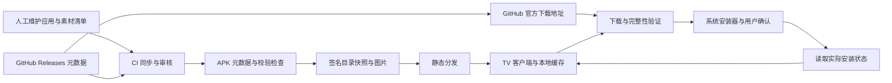

# GitHub 开源应用商店：产品与开发计划

更新日期：2026-11-10

状态：已进入 v0.1 开发预览；当前范围与验证结果见[实现记录](implementation-status.md)，真机与公开发行验收仍待完成。

首发平台：Android TV / Google TV。

长期平台：Android 手机和平板、Web、Windows、macOS、Linux。

## 1. 产品定位与首版决策

让普通用户像使用常规软件商店一样，发现 GitHub 上的开源应用，查看介绍和截图，选择适合设备的安装包，完成下载、安装和更新。

首版采用**精选应用目录 + GitHub Releases 官方发布包 + 原生 Android TV 客户端**。重点是可信来源、漂亮的详情页、遥控器操作和可靠的安装更新闭环。

以下为规划假设，可以在开发前调整，不代表用户已经确认：

- 面向个人普通设备，不依赖 Root、ADB、设备所有者或系统签名权限。
- 首版无需登录，中文优先，界面文案预留国际化。
- 首轮验证 5 个应用，内测收录 10–15 个，公开测试目标 20–30 个；数量服从质量。
- 首版公开目录只收录已有 TV 真机实测记录的应用；有操作限制的条目必须明确标注，首页仅推荐遥控器完整可用项。仅声明支持 TV、未验证和不适合 TV 的应用留在维护候选目录。
- 先支持可独立安装的 APK；Split APK、APKS、XAPK、APKM、AAB 暂不支持。
- 初步最低系统为 Android 8.0 / API 26；M0 根据真实目标设备再确定。targetSdk 在开工时依据最新稳定 SDK 与发行渠道要求确定。
- 商店自身先通过项目 GitHub Releases 分发，提供首次侧载指南；是否进入 Google Play 另行评估，不作为首版上线前提。
- 首版维护静态目录和同步流水线，不建设账户系统、评论系统和完整运营后台。

## 2. 对现有构想的补充

| 补充项 | 用户价值与处理方式 | 优先级 |
| --- | --- | --- |
| TV 适配标识 | 区分“遥控器实测可用”“仅声明支持 TV”“未验证”“不适合 TV”；首页仅推荐实测项 | P0 |
| 自动选包 | 根据 Android 版本、CPU ABI、渠道、包名选择兼容资产；不能让普通用户猜 arm64 / universal | P0 |
| 下载管理 | 显示进度、大小、排队、取消、失败原因、重试，处理中断恢复和空间不足 | P0 |
| 来源与校验 | 显示原仓库、发布者、许可证、原始 Release、校验状态；开源不等于安全 | P0 |
| 更新中心 | 显示已装版本与可升级版本、更新日志、忽略某版本、重新检查 | P0 |
| 历史版本约束 | 支持浏览和选择可用旧包，同时说明兼容性、签名和降级限制 | P0 |
| 内容维护 | 图标、横幅、截图、中文简介、标签、素材来源和 TV 实测记录都需要维护 | P0 |
| 离线与异常体验 | 缓存目录可浏览，标记最后同步时间；网络失败不等于没有应用或没有更新 | P0 |
| 商店自身更新 | 与普通应用使用同一校验和安装链路，保护发布签名密钥 | P0 |
| 收藏与版本固定 | 收藏常用应用，固定某版本并暂停提示；本地存储即可 | P1 |
| 稳定版 / 测试版订阅 | 默认稳定版，按应用显式选择测试版，避免误装预发布版本 | P1 |
| 手机辅助输入 | 扫码查看仓库；后续增加扫码配对、发送搜索词或仓库链接 | P1 |
| 添加自定义仓库 | 高级用户添加 GitHub URL，解析失败时可选资产；不自动进入精选目录 | P1 |
| 批量更新 | 批量下载、逐项处理安装确认，不承诺所有设备无交互安装 | P1 |
| 应用提交与问题反馈 | 后续建立收录申请、错误素材反馈、失效包和签名变更审核流程 | P1 |
| 账户、评论、个性化推荐 | 有足够用户和内容后再做，避免首版承担同步和内容治理成本 | P2 |

P0 为公开测试版必须完成；P1 为闭环稳定后追加；P2 为长期候选。

## 3. 必须明确的技术边界

### 3.1 GitHub 仓库不是现成的应用目录

GitHub Releases 提供版本、发布说明和附件等信息，但“存在仓库”“存在标签”“存在可安装 APK”是不同条件。Release 列表也不等于全部 Git 标签列表。[GitHub Releases API](https://docs.github.com/en/rest/releases/releases)

产品因此维护独立目录：一个仓库可对应多个应用，一个应用可有多个平台变体，一个 Release 可有多个安装包。首版不把 GitHub 全站仓库搜索包装成应用商店搜索。

图标、截图、宣传图、分类、中文介绍和 TV 实测结论由收录流程补全。优先使用作者提供且可使用的素材，记录来源与使用依据；缺图时使用统一占位，不生成冒充真实功能的截图。公开测试收录项要求有介绍、图标及至少两张真实截图；缺少 TV 截图时必须标注截图所属平台。

### 3.2 安装和更新依赖系统能力

通过 `PackageInstaller` 安装，处理允许此来源安装应用的设置、系统确认、用户取消、会话回调和失败状态。普通第三方安装器应始终能处理 `STATUS_PENDING_USER_ACTION`；不把静默安装作为产品承诺。[PackageInstaller](https://developer.android.com/reference/android/content/pm/PackageInstaller)、[SessionParams](https://developer.android.com/reference/android/content/pm/PackageInstaller.SessionParams)

同名应用不一定能覆盖更新：包名、签名及签名轮换关系必须兼容。例如商店渠道和 GitHub 渠道可能采用不同签名。客户端预检查并解释冲突，系统安装结果为最终依据。[Android 应用签名](https://developer.android.com/studio/publish/app-signing)

### 3.3 历史版本选择不等于无损回退

Android 使用内部版本信息防止降级。用户可以浏览、下载历史包；未安装时可安装兼容旧版本，已安装新版时不能承诺直接覆盖成旧版。[Android 版本管理](https://developer.android.com/studio/publish/versioning)

首版遇到降级只解释限制，并提供独立的系统卸载入口。卸载可能删除数据，必须由用户明确操作，不自动“卸载后重装”，不承诺替其他应用备份私有数据。历史资产如果被上游删除，不保证永久可下载。

### 3.4 已安装应用识别存在可见性限制

Android 11 及以上存在包可见性过滤，不能假设可枚举全部应用。[包可见性说明](https://developer.android.com/training/package-visibility)

首版“我的应用”定义为**目录内且当前可识别的已安装应用**。构建时生成精选包名的 `<queries>`，结合系统提供的可见性和安装记录处理状态。动态新增包名可能需要发布新客户端才能可靠识别，不把本地安装记录当作当前系统事实；无法确认时显示“安装状态未知”。若未来要覆盖任意仓库，再单独验证广泛包可见性权限及发行渠道要求。

### 3.5 网络、API 与分发政策是上线依赖

GitHub REST API 的常见主限额为未认证每 IP 每小时 60 次、认证用户每小时 5,000 次，另有搜索及次级限额。集中同步、缓存和条件请求比每台电视频繁查询更适合首版。[API 限流](https://docs.github.com/en/rest/using-the-rest-api/rate-limits-for-the-rest-api)、[API 最佳实践](https://docs.github.com/en/rest/using-the-rest-api/best-practices-for-using-the-rest-api)

下载首先直连 GitHub 官方资产，目录和图片使用独立静态分发。目录能打开不代表安装包能下载；M0 要在目标网络测试。如果直连无法满足目标用户，应先确定可运营的官方来源分发方案，再扩大公开测试。首版不默认接入不明第三方代理。

截至本文日期，Android 官方已公布开发者验证的分地区、分参与商店推进安排。不能据此推断全部电视已经统一受限；需在发布前核对目标地区、设备认证状态、商店适用范围和安装失败表现，并处理相关系统错误。[Android 开发者验证](https://developer.android.com/developer-verification)

## 4. 首版用户体验与页面

### 4.1 页面结构

| 页面 | 核心内容 | 遥控器行为 |
| --- | --- | --- |
| 首页 | 编辑精选、最近更新、分类横排、TV 适配标签 | 左侧导航与内容区有明确切换，返回保留焦点和滚动位置 |
| 分类 / 搜索 | 名称、别名、简介、标签搜索；兼容性筛选 | 系统输入法；无结果、加载和错误状态均可操作 |
| 应用详情 | 图标、真实截图、简介、功能、作者、许可证、大小、版本、要求、更新说明、来源 | 默认焦点落在主操作；截图支持全屏浏览与返回 |
| 版本列表 | 稳定 / 预发布标识、日期、日志、兼容资产、大小、校验状态 | 不兼容项说明原因；选定历史版后主按钮内容同步变化 |
| 下载中心 | 任务队列、进度、重试、取消、等待确认与失败原因 | 不因进度刷新抢走焦点；安装弹窗返回后恢复原任务 |
| 我的应用 / 更新 | 已安装、可更新、忽略版本、打开、卸载入口 | 无 TV 启动入口时解释原因，不显示无效“打开”按钮 |
| 设置 / 关于 | 手动同步、缓存清理、网络状态、隐私、商店版本与更新 | 所有开关和提示均支持方向键与确认键 |

### 4.2 视觉与交互标准

- 已确认采用苹果式的简洁大气风格：克制的配色、清晰文字层级、宽松留白与轻微焦点动效，按电视遥控器场景实现。
- 使用适合客厅距离的字号、留白和卡片；以深色主题、横幅和截图建立商店感，避免把手机页面放大。
- 统一颜色、字体层级、圆角、间距、图标和图片比例，先完成首页、详情页、版本选择三张高保真设计。
- 焦点使用边框、亮度或轻微缩放，不能仅依赖颜色；动画简短，不影响快速连续移动。
- 全流程只用方向键、确认和返回即可完成，不依赖触摸、鼠标或长按隐藏操作。
- 适配 1080p / 4K 显示，检查边缘安全区域、长中文名称、超长版本号和截图裁切。
- 商品卡片不宣称 Stars 等于质量；如展示 Stars 或下载量，标明其来自 GitHub 的统计口径。
- “大小”明确为选中安装包的下载大小；安装占用未知时不把 APK 大小当作磁盘占用。

Compose for TV 是 Android 官方面向 TV UI 的现代方案，因此推荐采用原生 TV 组件，而非先套用手机组件库。[Compose for TV](https://developer.android.com/training/tv/playback/compose)

## 5. 推荐架构

### 5.1 Android 与目录基础设施

| 层级 | 建议方案 | 选择理由 |
| --- | --- | --- |
| TV 客户端 | Kotlin、Jetpack Compose for TV | 优先保证遥控器焦点、TV 体验与安装能力 |
| 状态与业务 | ViewModel、Coroutines / Flow，按目录、下载、安装、更新分层 | 业务规则独立于页面，便于测试和后续 Android 移动端复用 |
| 本地数据 | Room 存目录缓存与任务；DataStore 存设置 | 支持离线浏览、重启恢复和状态持久化 |
| 网络与图片 | OkHttp / Retrofit、Coil，开发时锁定兼容稳定版本 | 常规 HTTP、图片缓存与请求控制 |
| 后台检查 | WorkManager 做可延迟的目录同步和更新检查 | 定时检查允许被系统推迟；同时提供手动刷新 |
| 下载执行 | 独立 DownloadEngine；M0 验证 UIDT / 前台服务的系统版本分支 | 长下载需适应后台限制，不把 UI 生命周期当任务生命周期 |
| 系统安装 | PackageInstaller、PackageManager | 获取真实包信息、安装结果和启动入口 |
| 内容目录 | Git 管理的 YAML / JSON + JSON Schema | 内容变更可审查、可追踪，无需先做后台 |
| 同步与分发 | CI 定时同步 + APK 元数据检查 + 静态 JSON / 图片分发 | 降低客户端 API 压力与服务端运维复杂度 |

长时间下载的具体调度方案必须实机验证。Android 官方提供用户发起的数据传输任务方案；不同版本应采用合适机制，不把所有长下载直接塞进一个普通 Worker。[数据传输任务选型](https://developer.android.com/develop/background-work/background-tasks/data-transfer-options)、[用户发起的数据传输](https://developer.android.com/develop/background-work/background-tasks/uidt)

### 5.2 数据流

首版不常驻部署业务 API，不代理安装包流量。同步凭据仅保存在 CI 的密钥管理中，不写入 APK、目录文件或日志；只读所需公开仓库数据，不申请不必要权限。对于没有管理权限的第三方仓库，使用低频条件轮询，不假设能配置其 Webhook。

初始同步目标为每 6 小时一次，客户端启动时按缓存有效期检查目录，提供手动刷新。这个频率是运营目标而非实时保证；UI 始终显示最后成功同步时间。

### 5.3 未来平台复用边界

优先复用目录协议、内容、素材、兼容性规则和测试样例；Android 手机 / 平板复用 Kotlin 数据与业务模块，另建触摸交互页面。Windows、macOS、Linux 的安装器、权限、应用识别和签名验证分别实现平台适配器。

现在不为了“所有平台一套 UI”牺牲 TV 体验，也不提前决定桌面框架。待桌面阶段用真实安装包验证后再选型。Web 首先只提供发现、搜索、版本查询和下载跳转；浏览器不能承诺管理本机全部应用或直接执行原生安装。

## 6. 数据模型与目录协议

| 实体 | 必要字段 / 关系 |
| --- | --- |
| App | 稳定 `appId`、名称、多语言简介、分类、标签、图标、截图、许可证、来源、收录状态 |
| Repository | GitHub 仓库 ID、owner / repo、仓库 URL、归档 / 转移状态；仓库路径变化不改变 appId |
| PlatformVariant | appId、平台、Android 包名、渠道、资产匹配规则、TV 兼容等级；一个应用可有多个变体 |
| Release | 仓库 Release ID、原始 tag、展示版本、发布时间、预发布状态、日志、上游 URL |
| Asset | GitHub asset ID、文件名、下载 URL、字节大小、类型、ABI、minSdk、versionCode、包名、签名证书指纹、摘要及来源、验证时间、分发状态与禁用原因 |
| Media | 文件地址、类型、所属平台、语言、来源、使用依据、替代文本 |
| CompatibilityReport | 设备型号、系统版本、ABI、遥控器可用性、测试版本、测试时间、结论 |
| InstalledApp | 本机包名、实际 versionCode / versionName、可见性状态、签名信息、来源；只保存在设备端 |
| DownloadTask | taskId、asset ID、预期摘要、状态、已下载字节、总字节、ETag、临时文件、错误与安装 session ID |
| UserPreference | 忽略版本、后续版本固定 / 渠道订阅、缓存策略、最后检查时间 |
| CatalogSnapshot | schemaVersion、递增 revision、generatedAt、最低可读客户端版本、数据摘要与签名 |

关键约定：

1. `versionName` / tag 用于展示，Android 升级判断以实际 `versionCode` 为核心；不比较字符串大小，也不假设所有项目采用 SemVer。
2. 文件名与正则仅用于候选筛选。同步端检查真实 APK 元数据，客户端安装前再次核对；无法识别的资产不进入自动更新。
3. 默认只推荐稳定版本；预发布历史记录可显示，安装需明确选择。版本缺失或上游删除时显示不可用原因。
4. 候选必须匹配包名、SDK、ABI 和明确的渠道。相同 ABI 多包无法区分时采用审核规则，不能随便选第一个。
5. 摘要可来自 GitHub asset 的 `digest`；缺失时由同步端对审核过的原始文件计算并记录来源。资产接口提供大小、下载地址等信息，下载实现需处理重定向。[GitHub Release Assets API](https://docs.github.com/en/rest/releases/assets)
6. 文件哈希用于完整性验证，APK 签名用于身份与升级关系判断，两者不互相替代；同来源哈希也不是“无恶意”的证明。
7. GitHub 同一 Release 的资产可能变化。以 asset ID、摘要和更新时间识别变化；已审核文件变化或签名变化进入隔离审核，不静默沿用旧信任。
8. 首版导入各应用最近最多 20 个含受支持 APK 的公开 Release，按需调整。UI 标明覆盖范围，不声称提供上游全部历史；被删除资产不做永久归档承诺。
9. 静态快照使用标准签名库验证，客户端内置目录公钥；签名私钥独立保管。异常快照拒绝加载，保留上次有效版本。回退内容应发布更高 revision 的修正版，并预留密钥轮换流程。

历史导入采用分批策略：首次优先处理最新稳定版与最近两个可用历史版，再逐步扩展到上限。历史包完成包信息和签名检查不代表全部做过 TV 实测，UI 分别标注。常规同步只检查新增或变化资产，缓存检查结果，不重复下载全部历史文件。

## 7. 核心流程与异常处理

### 7.1 首次安装

浏览详情 → 选择默认兼容版本 → 下载前检查网络和可用空间 → 加入队列 → 下载 → 校验文件、包名、SDK、ABI、签名 → 引导允许安装来源 → 提交系统安装 → 用户确认 → 读取系统结果 → 显示“打开”或明确失败原因。

空间检查要考虑临时文件与安装器所需额外空间；不足时提供缓存清理入口，不宣称精确预测最终安装占用。首次签名信任来自人工审核的目录，不能把任意首次下载的证书直接当作可信身份。

### 7.2 下载任务

建议状态：`QUEUED → DOWNLOADING → VERIFYING → READY_TO_INSTALL → WAITING_USER → INSTALLING → INSTALLED`，另有 `FAILED`、`CANCELLED`、`INTERRUPTED`。

- 默认同时下载 1 个文件，任务去重；对同一包名串行安装。
- 断线采用有上限的重试和退避，明确区分 404、限流、超时和磁盘不足。
- 首版保证取消、失败重试与中断后恢复任务；后台暂停 / 恢复按钮作为 P1，不假装所有服务器支持续传。
- 续传只有在 Range、ETag / 资源身份满足条件时使用；资产变化或服务端不支持时重新下载，避免拼接损坏文件。
- 重启后核对本地文件、下载状态、安装会话和真实已安装版本，再决定继续或重试。
- 校验失败不能转入安装；临时文件设清理期限，安装成功后默认清除安装包。
- 系统弹窗关闭或用户取消不等于安装成功；权限页返回后重新检查授权状态。
- 收到有效目录中的资产禁用信息后，取消其排队或下载任务，禁止已下载文件继续提交安装。安装前及任务恢复时重新检查最新本地禁用状态；已交给系统的会话尽力取消，不能保证撤回已完成的安装，也不远程卸载。
- 首版安装提交要求最后成功取得的有效目录不超过 24 小时；超时则等待联网刷新，离线仍可浏览缓存。时限内遇到刷新失败时显示检查时间，并按已有目录处理；此策略不能保证实时获知撤回，作为待 M0 确认的产品取舍。

### 7.3 更新与历史版本

读取可见的目录内已装应用 → 刷新目录 → 过滤渠道和兼容资产 → 比较内部版本并检查签名 → 显示可更新列表 → 用户选择 → 复用下载与安装流程。

默认后台只检查，不自动下载或安装。忽略版本按应用 + 渠道 + versionCode 记录。历史版先展示发布日期、日志、兼容性和可用性，再判断是可安装、可升级、相同版本或降级受限。遇到证书轮换等无法可靠判断的情况转人工规则审核，不建议用户绕过系统验证。

## 8. 内容收录与运维

收录流程：提交仓库 → 确认开源许可证与官方发布来源 → 检查 APK 包名和证书 → 配置资产规则 → 补充介绍和素材 → TV 真机验证 → 合并目录变更 → 同步生成快照 → 上架。

首版新 Release 自动同步为候选，包名、渠道、签名、摘要和兼容性检查通过后，由维护者确认日志与变化再发布；包名、签名、资产规则或最低系统要求等异常变化必须复审。新推荐版本完成 TV 核心操作冒烟后更新实测标识；未完成时仍保留上一已审核推荐版本。界面分别显示“上游最新版本”“商店已审核版本”和实测版本，不能把旧版实测结论直接标在新版上。每 6 小时是发现目标，不是审核上架时限；若维护量过大，先缩减目录，再评估自动上架规则。

- 原仓库可访问但许可证不明确的应用暂不进入“开源精选”。记录素材来源及使用依据；镜像或再分发计划需独立确认许可证义务。
- 自动化只下载并检查发布物，不执行上游仓库脚本或未经审查的构建任务。
- 素材 URL 和发布说明视为外部输入，限制内容长度、格式和图片尺寸；不直接执行 README 中的 HTML / JavaScript。
- 对 GitHub 仓库转移、归档、资产删除、签名异常、同步超时提供维护记录；异常新版本隔离，不覆盖已验证版本。
- 维护者可撤回推荐或禁用特定资产并注明原因；不远程卸载用户应用。
- 首版通过 Git 变更审查维护内容，提供项目反馈入口，后续再建设后台。
- 记录同步失败率、目录新鲜度、静态托管存储 / 流量和构建耗时，按试运行数据估算月成本；不预设长期零成本。
- 应用列表、安装记录默认留在本地；诊断日志由用户主动导出并去除敏感字段，是否接入崩溃遥测在发行前明确。

## 9. 开发里程碑

以下以 **1 名熟悉 Android 的全职开发者，能投入设计与内容维护时间** 为估算基线，首版约 **10–14 周**，不是固定交付承诺。首次学习 Kotlin / TV 开发、只能兼职或目标设备差异较大时，应额外预留时间。实际排期在 M0 后校准。

| 阶段 | 工作量估算 | 主要产出 | 退出条件 |
| --- | --- | --- | --- |
| M0 可行性验证 | 1 周 | 5 个候选应用样本、设备与网络矩阵、安装原型、技术决策记录 | 在目标真机完成下载、安装、升级；验证签名冲突、旧版限制、包可见性和后台下载 |
| M1 产品与工程底座 | 1–2 周 | 三张核心页面设计、TV 工程、目录 Schema、假数据页面、构建流水线 | 遥控器可完整操作首页→详情→版本页；组件与焦点规则确定 |
| M2 真实目录与发现 | 2 周 | 同步脚本、审核与签名快照、图片缓存、搜索分类、10–15 个收录项 | 真实数据可浏览，断网可读缓存，异常同步保留上次有效目录 |
| M3 下载与安装闭环 | 2–3 周 | 下载队列、持久化、校验、系统安装、错误恢复 | 正常安装和主要异常场景通过；进程终止后恢复状态不误报成功 |
| M4 更新与历史版本 | 1–2 周 | 已装识别、更新中心、忽略版本、历史选择、商店自更新 | 正确区分升级、同版、降级、签名冲突和不兼容包 |
| M5 公开测试准备 | 2–3 周 | 真机回归、性能与视觉优化、20–30 个优质条目、签名 APK、用户指南 | 达成发布验收，可从锁定依赖的源码在干净环境构建，发布密钥和内容撤回流程演练完成 |

总计 9–13 周功能工作，另留约 1 周整体缓冲，即 10–14 周。设计和内容录入可穿插，但 M0 安装验证先于大规模界面建设，下载安装稳定先于批量更新。

### M0 首周任务清单

- [ ] 选择至少两台真实目标设备：一台低内存 / 较旧系统，一台较新系统；确认 32 位 / 64 位运行环境，不仅看芯片型号。
- [ ] 记录 5 个候选应用的仓库、许可证、截图来源、包名、签名、minSdk、ABI、版本历史和 TV 操作表现。
- [ ] 记录单应用素材整理、真机验证、历史 APK 导入的耗时、流量与存储，用于校准总排期和收录数量；质量门槛不随数量目标降低。
- [ ] 用自有测试 APK 构造同签名新旧版本、异签名同包名、错误 ABI 和损坏文件，验证预期行为。
- [ ] 完成一个最小 TV 页面，跑通“获取文件 → 校验 → 系统安装 → 获取结果”。
- [ ] 测试未知来源授权、用户取消、设备策略拒绝、存储不足和系统安装器焦点。
- [ ] 测试包可见性方案是否足以识别首批应用，记录动态收录的限制。
- [ ] 测试目标网络的目录访问、图片加载、GitHub 资产重定向与大文件下载。
- [ ] 验证下载后台执行与进程终止后的恢复；据此确定下载引擎的版本分支。
- [ ] 确定 minSdk、测试设备、TV 收录门槛、安装前目录新鲜度策略、静态分发位置与首版视觉方向，再进入 M1。

## 10. 验收与测试策略

### 10.1 首版功能验收

- 无需登录即可完成浏览 → 详情 → 下载 → 系统确认安装 → 打开 → 检查更新 → 更新。
- 全流程只用遥控器；所有可交互控件有焦点反馈，返回后恢复原位置，无焦点死角。
- 所有公开收录条目都有来源、许可证、图标、介绍、真实截图、TV 适配说明、可下载版本及准确的下载大小。
- 默认选包在测试矩阵上正确；无法判定时停止自动选择并说明原因。
- 历史版本可浏览和选择，明确覆盖范围；不能直接降级的情况不显示误导性的“一键回退”。
- 签名冲突、摘要不匹配、无兼容包、来源授权失败、取消安装、下载 404、断网和空间不足均有可理解的结果与下一步。
- 网络失败不清空缓存或把错误显示为“暂无更新”；安装状态未知不显示为“未安装”。
- 商店自更新可完成；更新失败不删除当前可运行的商店。
- 资产撤回演练覆盖排队中、下载中、已下载待安装和缓存过期四种状态，行为符合安装前目录新鲜度策略。

### 10.2 自动化与真机验证

| 层级 | 测试重点 |
| --- | --- |
| 规则单测 | ABI / SDK 过滤、多个 APK 选择、versionCode 比较、渠道、忽略版本和降级分支 |
| 数据契约测试 | 目录 Schema、字段缺失、版本兼容、签名失败、重复 appId、资产替换、分页和空 Release |
| 下载集成测试 | 重定向、Range 支持 / 不支持、ETag 改变、断网重试、限流、文件损坏、空间不足、重复任务 |
| 安装测试 | 使用受控 APK 验证新装、升级、签名冲突、低版本、用户取消；真实应用作人工冒烟 |
| UI / 真机测试 | 方向键焦点、返回恢复、系统弹窗、连续滚动、1080p / 4K、低内存、冷启动、进程恢复 |

性能初始目标：在 M0 选定的基准电视上，有缓存时首页可交互时间 P95 ≤ 2 秒；20 次冷启动测量，并标注设备与构建类型。以 60Hz 设备为例，重复焦点移动与列表滚动的基准测试中至少 95% 帧不超过 32ms，持续优化接近每帧 16.7ms。网络下载速度不作为客户端单方保证，分别记录首屏图片加载与安装包下载失败原因。

稳定性门槛：每台基准真机完成至少 20 次受控安装 / 更新循环，无误报成功；所有阻断核心流程的问题关闭，其他已知问题随测试版说明发布。

## 11. 后续版本路线

| 阶段 | 内容 | 开始条件 |
| --- | --- | --- |
| v0.1 Android TV | 本计划 P0，建立完整商店体验 | M0–M5 完成 |
| v0.2 TV 增强 | 收藏、版本固定、测试渠道、批量下载、自定义仓库、手机辅助输入 | 首版安装失败原因可解释、目录维护稳定 |
| v0.3 Android 手机 / 平板 | 复用业务层，增加触摸页面、自适应布局与分享入口 | TV 核心模块稳定；完成移动端权限和交互验证 |
| Web 发现站 | 在线目录、搜索、应用详情、平台过滤、版本查询、下载跳转、TV 使用指南 | 目录协议稳定后可提前，按内容规模决定是否需要后端搜索 |
| 桌面试点 | 按需求先选 Windows / macOS / Linux 之一，先下载与版本管理，再接安装 / 更新 | 验证该平台应用识别、签名、安装格式和升级路径 |
| 多平台运营 | 作者提交、维护后台、账户同步、可选镜像、更多来源 | 有真实规模与维护预算支撑 |

桌面平台单独处理 EXE / MSI、DMG / PKG、AppImage / deb / rpm 等格式，并尊重现有包管理器或应用自更新机制，避免两个更新器互相覆盖。首次桌面阶段只承诺选定格式和发行方式，不承诺统一管理所有软件。

## 12. 风险与控制点

| 风险 | 控制点 |
| --- | --- |
| 首页漂亮但应用不能安装 | M0 先验证真实设备与安装闭环，M3 作为后续能力的基础 |
| 内容质量低、维护量过大 | 控制收录数量，审核素材和版本映射；自动发现只生成候选 |
| APK 文件名或发布流程变化 | 正则候选 + 真实元数据检查；异常版本隔离 |
| 国内或目标网络访问不稳定 | 首周实测；目录独立分发，安装包问题单独决策，不掩盖失败 |
| 签名或供应链变化 | 原始来源、资产摘要、APK 签名、目录快照签名、人工异常审核 |
| OEM 限制 / 系统验证变化 | 实机矩阵与安装错误映射，发行前重新核对官方要求 |
| 过早做多平台导致拖延 | 首版只完成 TV；共享协议与业务边界，后续逐个平台落地 |
| 密钥丢失影响商店自更新 | 发布前完成安全备份、恢复演练和发布权限控制 |

## 13. 开发前待确定，但不阻塞本计划的事项

1. 首批目标用户、地区与真实电视型号，决定网络和系统兼容范围。
2. 品牌名称、图标与视觉偏好；工作名暂用 GitHub 开源应用商店，不暗示 GitHub 官方背书。
3. 实际开发人数、每周可投入时间、设计与内容维护负责人。
4. 首批希望收录的应用；当前默认采用“公开目录已有 TV 实测、首页遥控器完整可用”的门槛，在 M0 确认。
5. 是否有静态托管、域名和图片存储预算，未来是否计划进入 Google Play。

首轮已建立原生 TV 工程、5 个开发样本和可运行的下载安装链路。下一步补齐 M0 的实体设备与网络矩阵，以及受控 APK 的升级、降级和异常安装测试，再按 M5 标准扩大应用目录与安排公开测试。
